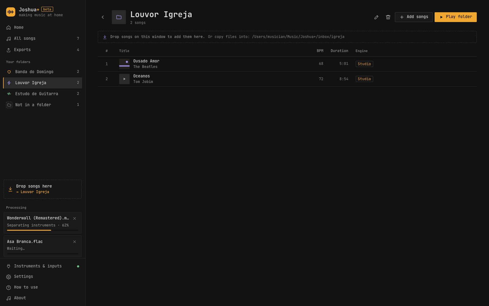
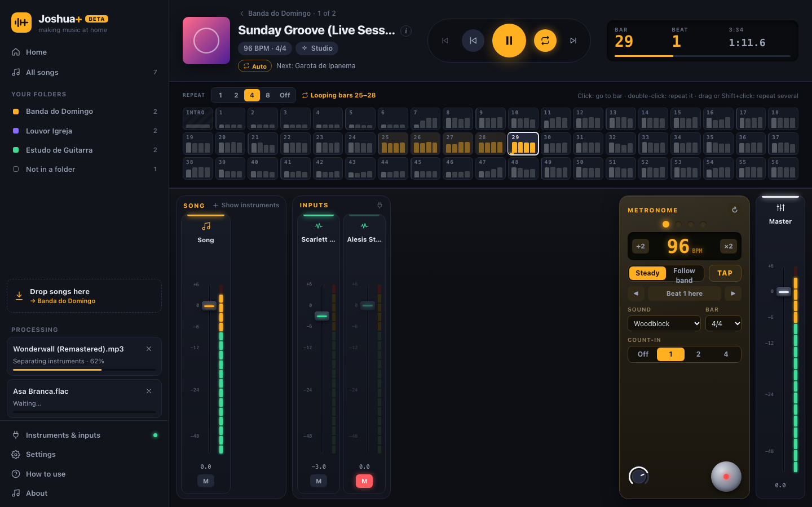
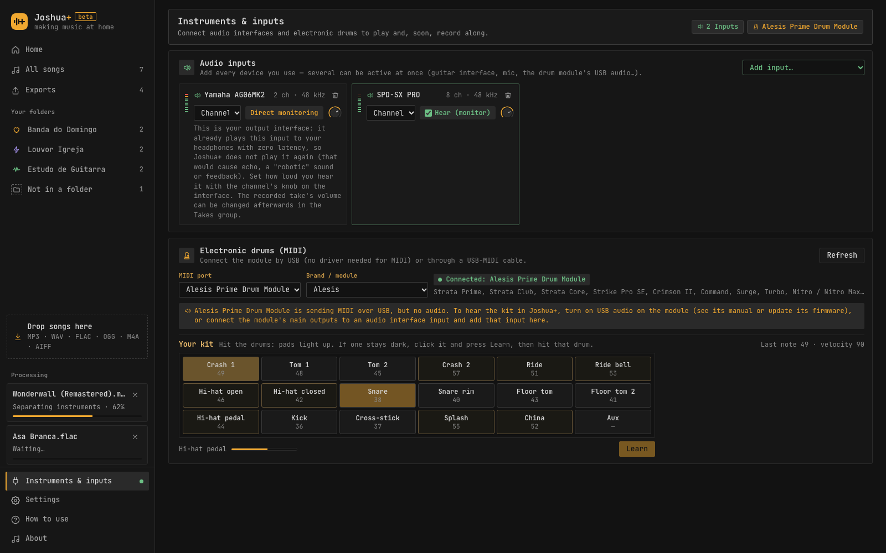
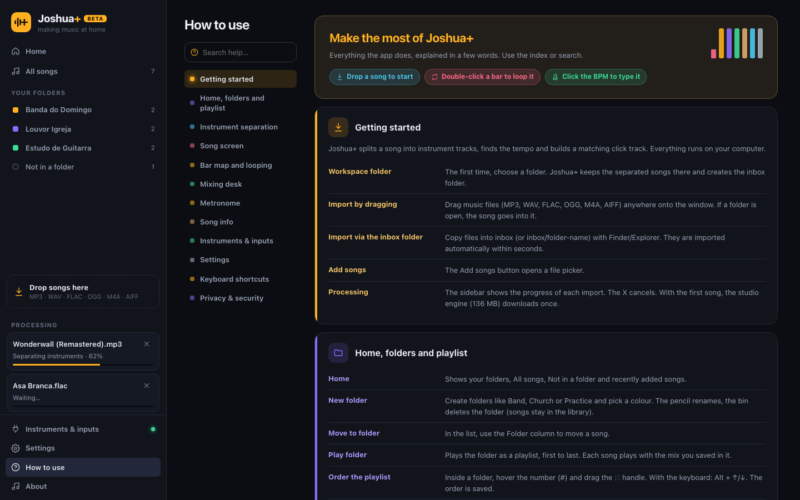
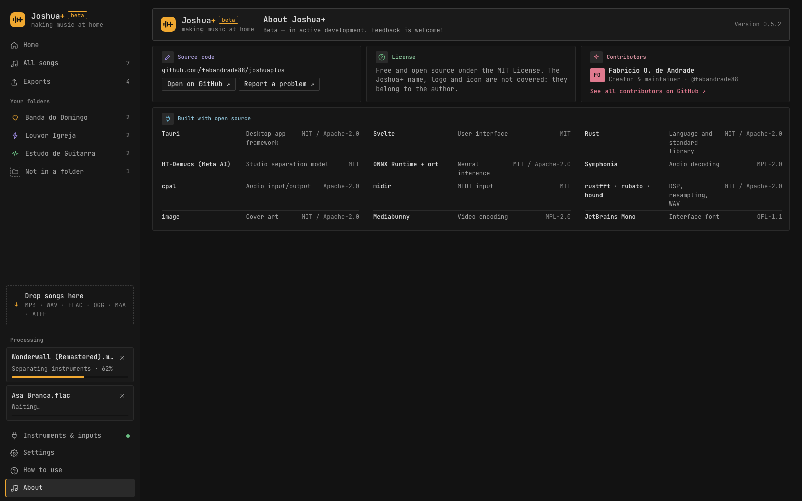

<p align="center">
  
</p>

<h1 align="center">Joshua+ <sup><code>beta</code></sup></h1>
<p align="center"><b>Fazendo música em casa.</b> Separe qualquer música em faixas de instrumentos, tenha um metrônomo que acompanha a música e toque junto.</p>
<p align="center"><i>"Moises led the way. Joshua takes you home"</i></p>

<p align="center"><a href="README.md">English</a> · Português (Brasil)</p>


O Joshua+ é um app desktop gratuito e de código aberto (MIT) para músicos que praticam em casa. Arraste uma música para ele e o app:

- **separa a música em faixas de instrumentos** (voz, bateria, baixo, guitarra, piano, outros) no seu próprio computador;
- **encontra o andamento e os compassos** e cria uma **faixa de metrônomo alinhada à música**;
- oferece um **mixer** com volume, mute, solo e pan por faixa;
- permite **repetir compassos**, contar a entrada e manter uma **playlist por pasta** que guarda todas as configurações.

Tudo roda localmente. Sua música só sai do computador se você escolher o separador na nuvem, que é opcional.

O app está em **English, Português (Brasil) e Deutsch**.

> **Beta 0.0.1.** Primeira versão pública. Por favor, [relate problemas](https://github.com/fabandrade88/joshuaplus/issues).

## Instalação

**macOS** (Apple Silicon ou Intel, macOS 13.4 ou mais novo) e **Linux** (x86_64, glibc 2.39+: Ubuntu 24.04+, Debian 13+, Fedora 40+):

```sh
curl -fsSL https://raw.githubusercontent.com/fabandrade88/joshuaplus/main/scripts/install.sh | sh
```

**Windows 10/11** (x64), no PowerShell:

```powershell
irm https://raw.githubusercontent.com/fabandrade88/joshuaplus/main/scripts/install.ps1 | iex
```

Como funcionam os scripts:

- Baixam a versão mais nova do GitHub. Para escolher uma versão, defina `JOSHUA_VERSION=v0.0.1-beta`.
- **Conferem o SHA-256 com o `SHA256SUMS` da release** e recusam instalar se não bater.
- No Ubuntu/Debian instalam o `.deb`; em outras distros, o AppImage em `~/.local/bin`.
- No Windows a instalação é por usuário, sem precisar de administrador.

Você também pode baixar os pacotes manualmente em [Releases](https://github.com/fabandrade88/joshuaplus/releases).

> As versões beta **ainda não são assinadas digitalmente**.
> - **macOS:** se instalar manualmente, clique com o botão direito no app e escolha **Abrir** na primeira vez.
> - **Windows:** o SmartScreen pode pedir **Mais informações → Executar assim mesmo**.

## Como usar

### 1. Home: suas pastas


Crie pastas para a banda, as aulas ou um show. Arraste arquivos de áudio para uma pasta ou para a janela. O app aceita MP3, WAV, FLAC, OGG, M4A/AAC e AIFF.

Cada pasta também tem uma **caixa de entrada** no disco: o que você colocar nela pelo Finder ou Explorer é importado sozinho.

### 2. Pasta = playlist



As músicas da pasta tocam em sequência, como um setlist. Arraste para reordenar. Cada música guarda as próprias configurações: mutes, volumes, correções de tempo, loop e som do click.

Capa e metadados (artista, álbum, ano…) vêm do arquivo. Só a capa aparece; clique nela para ver os detalhes. Você pode renomear qualquer música.

### 3. A música: faixas, mapa de compassos e click

- **Faixas:** cada instrumento separado tem fader, mute (M), solo (S) e pan.
- **Recolher a música:** você pode recolher todas as faixas da música em uma só. Isso deixa espaço para as faixas de gravação, que vêm numa versão futura.

  

- **Mapa de compassos:** é compacto, marca os tempos fortes e rola junto com a música.
  - Clique num compasso para pular para ele.
  - **Clique duas vezes num compasso para repeti-lo** até desligar o loop.
  - Escolha 1, 2, 4 ou 8 compassos para repetir uma frase inteira.
- **Metrônomo:** o click segue as batidas da própria música.
  - **Contagem:** de 0 a 4 compassos antes de começar, caindo exatamente no primeiro tempo da música.
  - **Sons:** seis opções (clássico, wood block, beep, cowbell, baquetas e bateria).
  - **Andamento:**
    - **constante**, o padrão para a maioria das músicas;
    - **variável**, para bandas ao vivo que aceleram e desaceleram;
    - **automático**.
  - **Correções:**
    - se o app pegou o tempo dobrado ou pela metade, use **×2 / ÷2**;
    - ajuste fino da grade, marcação do "1" do compasso e mudança da fórmula de compasso;
    - **tap tempo**, ou **digite o BPM exato**.
- **Navegação:** a música continua tocando enquanto você navega. Clicar nela de novo volta para a tela sem reiniciar.

### 4. Entradas de áudio, MIDI e baterias eletrônicas



- **Entradas de áudio:** até **8 entradas ao mesmo tempo** (várias interfaces de áudio, microfone USB…), cada uma com medidor de nível e retorno opcional.
- **Baterias eletrônicas e controladores MIDI,** com presets para:
  - **Alesis** (Strata Prime, Strata Club, Strata Core, Strike Pro SE, Crimson II, Command, Surge, Turbo, Nitro, Debut)
  - **Roland** V-Drums e **Yamaha** DTX
  - **EFNOTE**, **Simmons**, **Pearl**, **GEWA**, **ATV** e **Millenium**
  - kits General MIDI

  Use o **MIDI learn** para mapear qualquer pad.

### 5. Ajuda e Sobre

| Como usar | Sobre |
|---|---|
|  |  |

## Qualidade da separação

| Motor | Onde roda | O que entrega |
|---|---|---|
| **Estúdio (HT-Demucs, 6 faixas)** — padrão | No seu computador | Voz, bateria, baixo, guitarra, piano e outros, com pouco vazamento. Precisa de um download único de ~136 MB, verificado por SHA-256 |
| **Rápido (DSP)** | No seu computador, sem download | Separação instantânea por harmônico/percussivo e bandas de frequência |
| **Nuvem (LALAL.AI)** — opcional | Servidores do LALAL.AI, com a sua chave | Faixas extras, como **violão vs. guitarra**. Pago por você diretamente ao LALAL.AI |

## Como funciona

A arquitetura, os testes e as medições de desempenho estão no [README em inglês](README.md#how-it-works-architecture). Em resumo:

- **Rust:** decodificação (Symphonia), reamostragem (rubato), detecção de tempo (fluxo espectral, autocorrelação e programação dinâmica), mixer em tempo real sem locks e sem alocações (cpal + rtrb), separação neural (ONNX Runtime) e MIDI (midir).
- **Interface:** Svelte 5 dentro do Tauri 2, com CSP rígida e permissões mínimas.

## Testes e segurança

Nada vai para a `main` sem passar no CI (Linux, macOS e Windows):

- formatação, clippy, testes unitários e testes de propriedade;
- **fuzzing** de arquivos de mídia e capas;
- **testes de ataque** (path traversal, links simbólicos, FIFOs, arquivos gigantes, enxurrada de MIDI, CSP);
- verificação de tempo real (sem alocação no callback de áudio);
- pisos de desempenho;
- `cargo audit` e `pnpm audit`.

Veja o [SECURITY.md](SECURITY.md).

## Compilar a partir do código

```sh
git clone https://github.com/fabandrade88/joshuaplus.git
cd joshuaplus/app
pnpm install
pnpm tauri dev      # desenvolvimento
pnpm tauri build    # gera os instaladores
```

Os pré-requisitos (Rust, Node, pnpm e as bibliotecas do Linux) estão no [README em inglês](README.md#build-from-source).

## Código aberto usado

Tauri, Svelte, Vite, Symphonia, rubato, RustFFT/RealFFT, cpal, rtrb, midir, HT-Demucs (Meta AI, MIT), ONNX Runtime (`ort`), hound, image, ureq, rustls, sha2, serde e outros.

A tabela com licenças está no [README em inglês](README.md#open-source-used-by-joshua). A lista completa e gerada de ~600 pacotes está em [THIRD_PARTY_LICENSES.md](THIRD_PARTY_LICENSES.md).

## Como contribuir

Leia o **[CONTRIBUTING.md](CONTRIBUTING.md)** (em inglês). Ele explica:

- o fluxo de branches: `feature/*` → `test-branch` → `main`;
- as regras de código e boas práticas;
- os testes obrigatórios e o padrão de commits.

Leia também o [Código de Conduta](CODE_OF_CONDUCT.md). Vulnerabilidades devem ser relatadas **em privado**, pelo [SECURITY.md](SECURITY.md).

## Licença

[MIT](LICENSE) © 2026 **Fabricio O. de Andrade**
