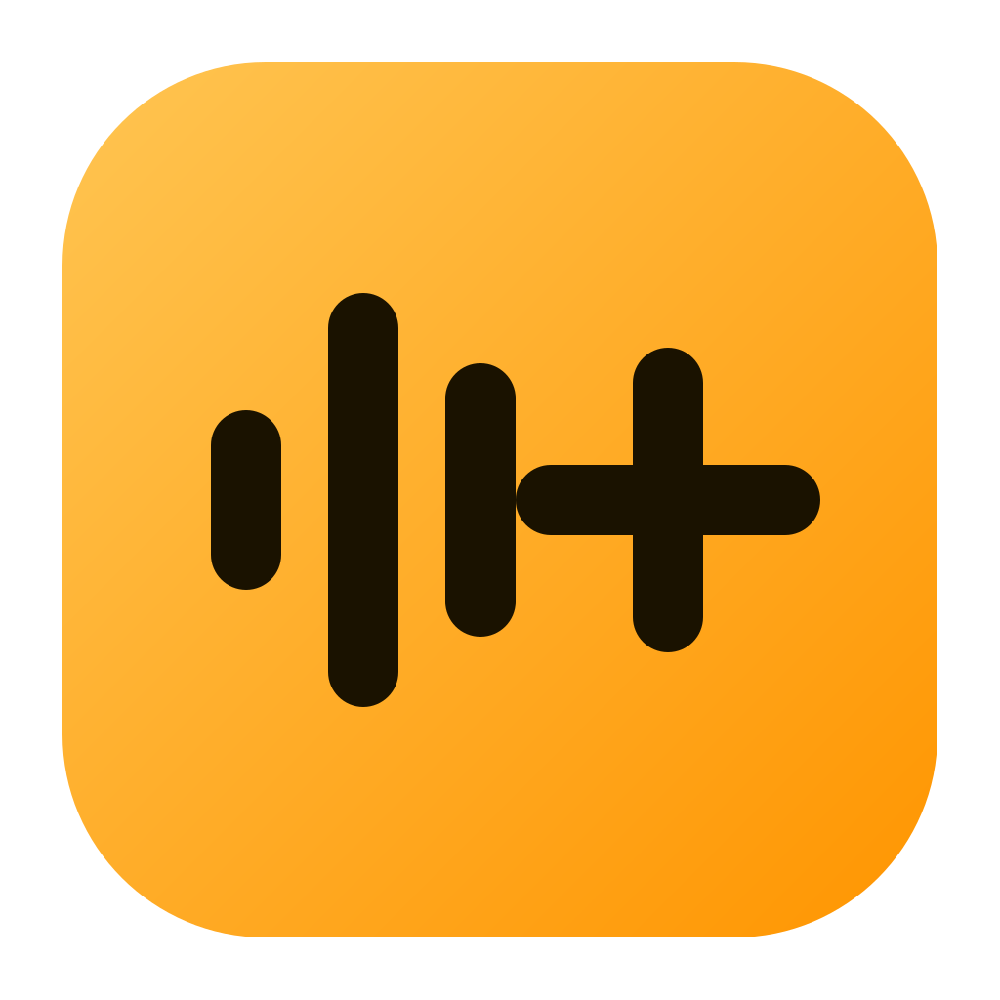
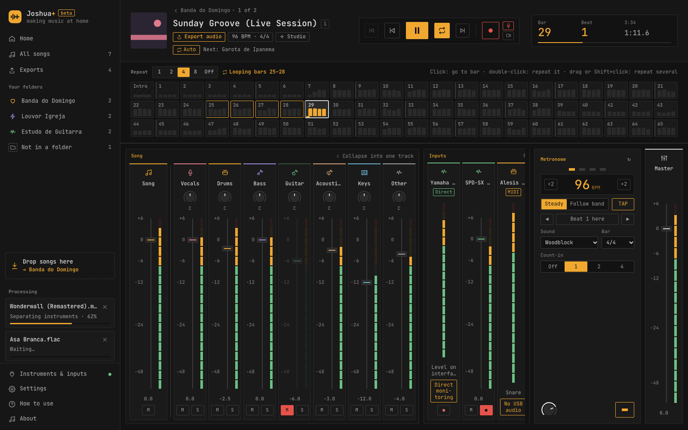
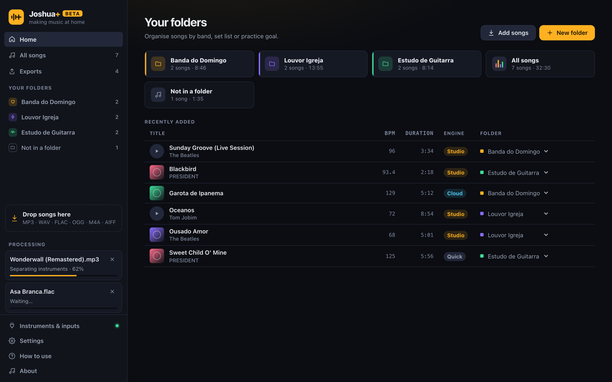
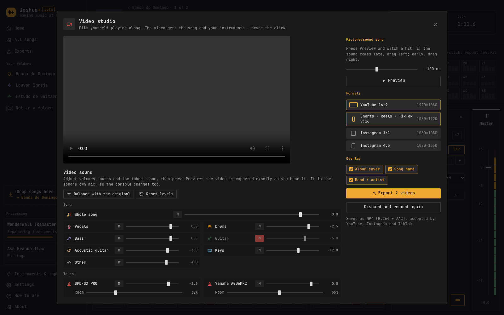
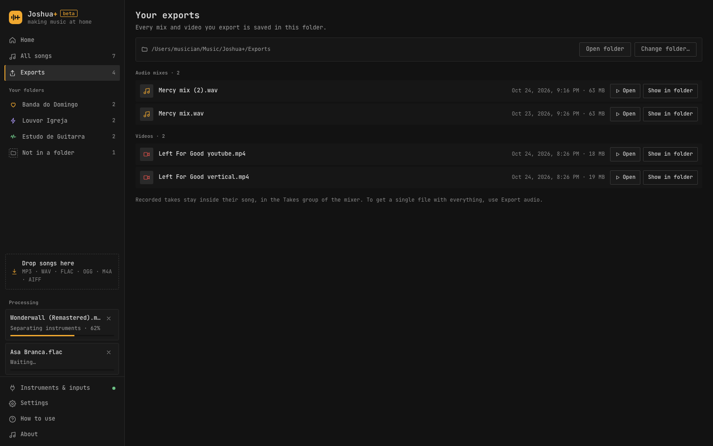

<p align="center">
  
</p>

<h1 align="center">Joshua+</h1>
<p align="center"><b>Fazendo música em casa.</b> Separe qualquer música em instrumentos, toque junto com um click preso à música, grave-se e compartilhe o vídeo.</p>
<p align="center"><i>"Moises led the way. Joshua takes you home"</i></p>

<p align="center">
  <a href="https://github.com/fabandrade88/joshuaplus/releases/latest"></a>
  <a href="https://github.com/fabandrade88/joshuaplus/actions/workflows/ci.yml"></a>
  <a href="LICENSE"></a>
  
</p>

<p align="center"><a href="README.md">English</a> · Português (Brasil)</p>



Gratuito e de código aberto (MIT). Roda no seu computador: sua música não sai dele. Em English, Português (Brasil) e Deutsch.

## Instalação

### macOS

Apple Silicon (M1 ou mais novo), macOS 13.4 ou mais novo. Cole no Terminal:

```sh
curl -fsSL https://raw.githubusercontent.com/fabandrade88/joshuaplus/main/scripts/install.sh | sh
```

### Windows

Windows 10 ou 11, 64 bits, sem precisar de administrador. Cole no PowerShell:

```powershell
irm https://raw.githubusercontent.com/fabandrade88/joshuaplus/main/scripts/install.ps1 | iex
```

### Linux

x86_64 com glibc 2.39+ (Ubuntu 24.04+, Debian 13+, Fedora 40+, Arch). Cole num terminal:

```sh
curl -fsSL https://raw.githubusercontent.com/fabandrade88/joshuaplus/main/scripts/install.sh | sh
```

Os scripts baixam a versão mais nova, **conferem o SHA-256 com o `SHA256SUMS` da versão** e só então instalam: o `.deb` com apt no Debian/Ubuntu, o AppImage em `~/.local/bin` nos outros Linux, o app em Aplicativos no macOS. São curtos; leia [`install.sh`](scripts/install.sh) e [`install.ps1`](scripts/install.ps1) antes, se quiser. Use `JOSHUA_VERSION=v0.5.2` para escolher uma versão.

**Prefere baixar na mão?** Pegue o `.dmg` (macOS), o `-setup.exe` ou `.msi` (Windows), ou o `.deb`, `.rpm` ou `.AppImage` (Linux) em [Releases](https://github.com/fabandrade88/joshuaplus/releases/latest). Os instaladores ainda não são assinados: no macOS, clique com o botão direito no app e escolha **Abrir** na primeira vez; no Windows, escolha **Mais informações → Executar assim mesmo**.

**Testado em:** Ubuntu 26.04 LTS, Omarchy (Arch Linux, Hyprland), Windows 11 e um MacBook Pro com M4 Pro (macOS 27). Em sistemas baseados no Arch, como o Omarchy, o script instala o AppImage e adiciona o Joshua+ ao menu de aplicativos.

Além disso, antes de cada versão ser publicada, todos os instaladores são instalados e abertos em máquinas limpas com Windows, macOS e Linux.

## O que você ganha

| | Recurso | Por que ajuda |
|---|---|---|
| 🎚️ | **Separação de instrumentos** em voz, bateria, baixo, guitarra, piano e outros, no seu computador (HT-Demucs) | Tire o instrumento que você toca e toque no lugar, ou deixe só ele para aprender |
| 🥁 | **Click preso à música**: andamento e compassos detectados, tempo constante ou variável, contagem, seis sons de click, TAP ou digitar o BPM | Pratique no tempo da gravação real, não numa grade que se perde |
| 🔁 | **Mapa de compassos e loops**: clique num compasso para ir, clique duplo para repetir, repita de 1 a 8 compassos | Repita a parte difícil até sair |
| 📁 | **Pastas como setlists** que lembram a mixagem, as correções de tempo e o loop de cada música | Abra a música e continue de onde parou |
| 🎤 | **Grave cada entrada no seu próprio take**, alinhado à música automaticamente (latência e diferença de clock corrigidas). Gravar de novo substitui o take anterior | Ouça como você tocou de verdade, junto com a banda |
| 🏠 | **Sala**: um ambiente comum para os seus takes | Bateria eletrônica ou guitarra em linha direta soam dentro da mixagem, não colados por cima |
| ⚖️ | **Equilibrar com o original**: cada gravação é ligada ao instrumento que toca e fica no volume e no lugar do estéreo dele, com o original silenciado; opcional depois de toda gravação. **Restaurar volumes** volta a mixagem inteira | Sua parte soa como se fosse do disco, com um clique |
| 🎬 | **Estúdio de vídeo**: grave-se com qualquer webcam, ajuste o som antes de exportar e exporte **YouTube 16:9, Shorts/Reels/TikTok 9:16 e Instagram 1:1 / 4:5** de uma vez, com capa, nome e banda opcionais, codificados quadro a quadro (H.264 High, 30 fps estáveis, som em sincronia). Nunca o click | Poste um play-along sem editor de vídeo |
| 💾 | **Exporte a mixagem** em WAV 24-bit, com ou sem o click. Tudo o que você exporta aparece em **Exportações** | Mande para a banda ou para o professor |
| 🎛️ | **Até 8 entradas de áudio** com medidores e retorno, **MIDI e baterias eletrônicas** (Alesis, Roland, Yamaha, EFNOTE, Simmons, Pearl, GEWA, ATV, Millenium, General MIDI) | Use o equipamento que você já tem |
| 🔌 | **Conecte e use**: desconectou uma interface ou câmera, o Joshua+ passa para o que está conectado e volta quando ela retorna | Sem reiniciar no meio do estudo |

| Início e pastas | Estúdio de vídeo | Exportações |
|---|---|---|
|  |  |  |

## Começando

1. **Escolha onde guardar a biblioteca** na primeira vez (o app sugere *Música › Joshua+*; dá para mudar depois em Configurações).
2. **Arraste uma música** (MP3, WAV, FLAC, OGG, M4A/AAC, AIFF) para a janela ou para uma pasta. Ela é separada em segundo plano.
3. **Abra a música**: tire o seu instrumento, ligue o click e aperte play.
4. **Grave**: arme uma entrada com ● e aperte o REC vermelho, ou troque o REC para a câmera para se filmar.
5. **Compartilhe**: *Exportar áudio* gera um WAV, ou exporte os formatos de vídeo que quiser. Os arquivos ficam em **Exportações**, na barra lateral.

A página **Como usar**, dentro do app, explica cada controle no seu idioma.

## Motores de separação

| Motor | Roda em | O que entrega | Custo |
|---|---|---|---|
| **Estúdio (HT-Demucs 6 faixas)**, padrão | Seu computador (CPU; DirectML no Windows, CUDA opcional) | Seis faixas limpas, cerca de 5× o tempo real num Apple M | Grátis. Download único de ~136 MB, verificado por SHA-256 |
| **Rápido (DSP)** | Seu computador, sem download | Separação instantânea de bateria e do resto | Grátis |
| **Nuvem (LALAL.AI)**, opcional | LALAL.AI, com a sua chave | Faixas extras, como violão × guitarra | Pago por você à LALAL.AI |

## Qualidade e segurança

Nada entra no `main` sem a CI verde em Linux, macOS e Windows ([ci.yml](.github/workflows/ci.yml)): `rustfmt`, `clippy -D warnings`, testes unitários e de propriedades, fuzzing com áudio e imagens maliciosos, suítes de ataque (path traversal, symlinks, bombas de decodificação, enxurradas de MIDI, CSP fixada), teste de tempo real garantindo que o áudio nunca aloca memória, pisos de performance, e `cargo audit` / `pnpm audit`. Código `unsafe` é proibido. Modelo de ameaças: [SECURITY.md](SECURITY.md).

Medido num notebook Apple M (vezes o tempo real): mixer 1426×, mixer com 4 takes na sala 556×, detecção de andamento 3497×, separação rápida 46×, leitura de WAV 6441×, reamostragem 1220×.

## Compilar a partir do código

Precisa de Rust estável, Node.js 20+ e pnpm 10. No Linux, também `libasound2-dev libwebkit2gtk-4.1-dev libayatana-appindicator3-dev librsvg2-dev libssl-dev`.

```sh
git clone https://github.com/fabandrade88/joshuaplus.git
cd joshuaplus/app && pnpm install
pnpm tauri dev      # rodar
pnpm tauri build    # instaladores em target/release/bundle
cargo test --workspace && pnpm check && pnpm test   # verificações
```

Arquitetura: app em Tauri 2 + Svelte 5 (`app/`) sobre quatro crates Rust: `joshua-core` (decodificação, andamento, metrônomo, mixer, sala, alinhamento das gravações, exportação, segurança da biblioteca), `joshua-engine` (áudio sem travas com cpal), `joshua-ai` (HT-Demucs no ONNX Runtime, cliente LALAL.AI) e `joshua-midi` (MIDI e mapas de baterias).

## Código aberto usado

A lista dos componentes principais, com licenças, está no [README em inglês](README.md#open-source-used-by-joshua). Todas as ~600 dependências, com versão e licença, estão em [THIRD_PARTY_LICENSES.md](THIRD_PARTY_LICENSES.md). A LALAL.AI é um serviço comercial, usado só se você adicionar a sua chave.

## Próximos passos

- Plugins de instrumento (EZdrummer, Superior Drummer…) dentro do Joshua+ ([#1](https://github.com/fabandrade88/joshuaplus/issues/1))
- Mudar velocidade e tom
- Instaladores assinados e notarizados, suporte a Mac Intel

## Como contribuir

Relatos de bugs, traduções, testes e código são bem-vindos. Leia [CONTRIBUTING.md](CONTRIBUTING.md) (fluxo `feature/*` → `test-branch` → `main`, regras de código, testes, checklist de revisão), [CODE_OF_CONDUCT.md](CODE_OF_CONDUCT.md), e relate vulnerabilidades em privado, como explica o [SECURITY.md](SECURITY.md).

## Licença

[MIT](LICENSE) © 2026 **Fabricio O. de Andrade**

A licença MIT cobre o código, não a marca: o nome **Joshua+**, o logo e o ícone do app pertencem ao autor e não podem ser usados em outros produtos nem em versões modificadas. Forks são bem-vindos com nome e ícone próprios. Veja [TRADEMARKS.md](TRADEMARKS.md) (em inglês).
